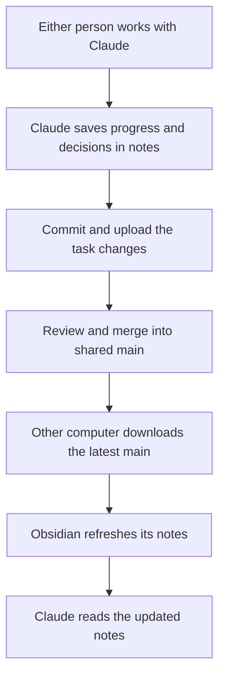

# Our shared second brain

[[00 START HERE|Back to Start Here]]

Both people use the same GitHub project. Obsidian opens the project's `notes/`
folder, and Claude Code opens the whole project containing `CLAUDE.md`.
The notes are the shared project memory.

## How information reaches the other person

The same loop works in both directions. Code stays in the project; notes record
what changed and why, with references to the affected files.

## What Claude should save

| Note | What belongs there |
| --- | --- |
| [[PROJECT]] | Lasting purpose, audience, and scope |
| [[STATUS]] | What currently exists, known issues, and next step |
| [[TASKS]] | Task ownership and progress |
| [[DECISIONS]] | Agreed decisions, proposals, and open questions, labelled |
| [[worklogs/README\|Task handoffs]] | Changed files, branch, checks, partial progress, and next action |

Claude's shared instructions already import the short core notes. They also ask
Claude to update progress and handoff notes as it works.

## The two habits that keep both people current

**Before working:** In GitHub Desktop, select the shared default branch, click
**Fetch origin**, then **Pull origin** if available. Preserve unfinished local
work on its task branch first. Ask an already-open Claude conversation to reread
the updated status, decisions, tasks, and recent handoffs before continuing.

**When sharing finished work:** Save the progress note with the task's changes,
commit and push the task branch, then review and merge it into shared main.
Merging publishes the website, notes included. The other person downloads main
before starting their next task.

Uploading a task branch alone does not change the other person's main branch.
If work needs to be seen before merging, share its branch name explicitly.
The other person can switch to that branch in GitHub Desktop, or read it on GitHub.

## What is automatic

- Obsidian refreshes notes when their local files change.
- Claude Code loads the project instructions and their imported notes at startup.

The current setup does not automatically push or pull GitHub changes. It also
does not copy full Claude conversations or make an active session reread new
files on its own. The instructions guide Claude; check its reported save/sync
state rather than assuming every step happened.

Claude's built-in automatic memory is local by default. The committed project
notes are the shared reference for this workflow.

## Quick prompt for an existing Claude session

Read the current CLAUDE.md and shared core notes, then inspect relevant recent
handoffs. Tell me what changed since our last session and what remains to do.
Preserve unfinished local work before downloading repository updates.

## Sources

- [Claude Code project memory](https://code.claude.com/docs/en/memory)
- [How Obsidian stores and refreshes notes](https://obsidian.md/help/data-storage)
- [GitHub Desktop push and pull](https://docs.github.com/en/desktop/working-with-your-remote-repository-on-github-or-github-enterprise/syncing-your-branch-in-github-desktop)
